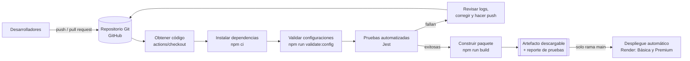
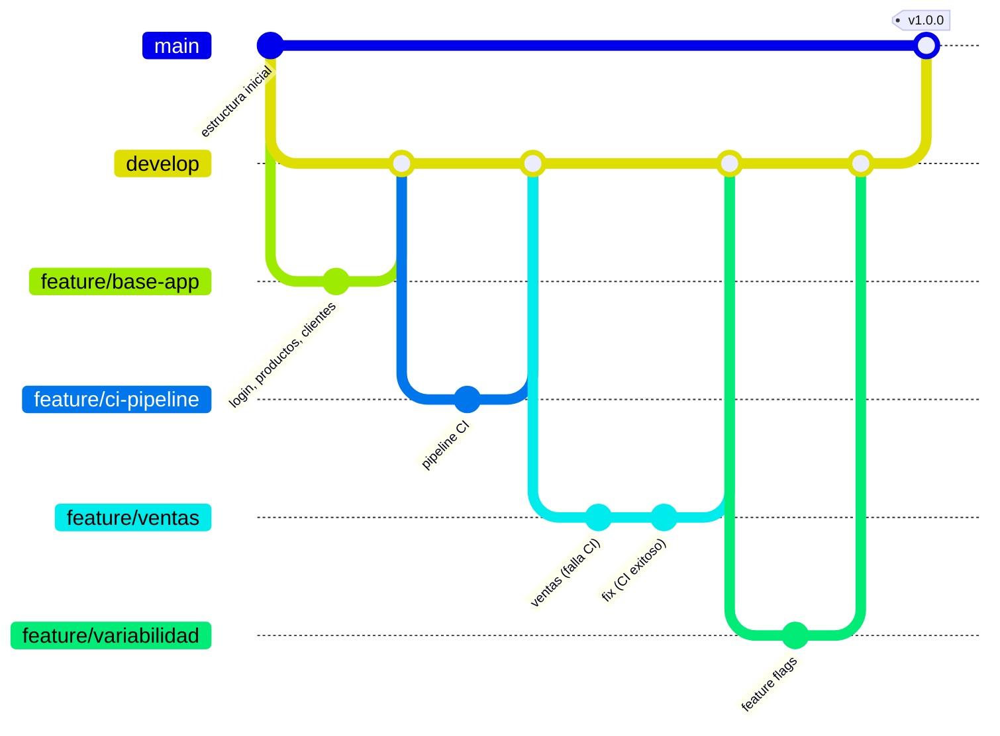

# Diagrama del flujo CI/CD

## Estrategia de ramas

| Rama | Propósito |
|---|---|
| `main` | Versiones estables publicadas. Cada merge despliega automáticamente. |
| `develop` | Integración de funcionalidades terminadas. |
| `feature/*` | Una rama por funcionalidad; se integra a `develop` mediante Pull Request con CI en verde. |
| `release/*` | Preparación de una versión (CHANGELOG, número de versión) antes de pasar a `main`. |

## Versionado semántico

Las versiones siguen `MAYOR.MENOR.PARCHE` y se marcan con etiquetas `vX.Y.Z` en `main`:

- **v1.0.0**: variante Básica con todas las características obligatorias.
- **v1.1.0**: variante Premium (reportes, descuentos y exportación) y despliegue continuo.
