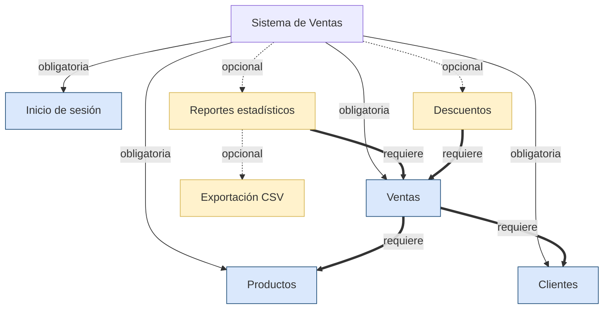

# Modelo de características

Fuente editable: [`modelo-caracteristicas.drawio`](modelo-caracteristicas.drawio) (abrir con [draw.io](https://app.diagrams.net)).
Fuente ejecutable: [`config/feature-model.json`](../config/feature-model.json), usada por el validador del pipeline.

| Característica | Tipo | Requiere | Básica | Premium |
|---|---|---|---|---|
| Inicio de sesión (`login`) | Obligatoria | — | Sí | Sí |
| Productos (`productos`) | Obligatoria | — | Sí | Sí |
| Clientes (`clientes`) | Obligatoria | — | Sí | Sí |
| Ventas (`ventas`) | Obligatoria | productos, clientes | Sí | Sí |
| Reportes estadísticos (`reportes`) | Opcional | ventas | No | Sí |
| Descuentos (`descuentos`) | Opcional | ventas | No | Sí |
| Exportación de reportes (`exportacion`) | Opcional | reportes | No | Sí |

## Reglas que verifica el validador

1. Toda característica del modelo debe declararse como `true` o `false`.
2. Las características obligatorias no pueden deshabilitarse.
3. No se aceptan características que no existan en el modelo.
4. Si una característica está habilitada, sus dependencias (`requires`) también deben estarlo.
5. Toda característica habilitada debe tener un módulo registrado en `src/features/registry.js`.

## Mecanismos de variabilidad

- **Archivos de configuración**: `config/<variante>.json` define qué características se habilitan.
- **Variables de entorno**: `VARIANT` selecciona la variante y `FEATURE_<NOMBRE>=true|false` sobrescribe una característica puntual (por ejemplo, `FEATURE_REPORTES=false`).
- **Registro de módulos (plugin)**: `src/app.js` recorre los feature flags y solo monta los módulos habilitados. El código es uno solo; la variante es una configuración.
- **Punto de extensión**: el módulo de ventas expone `pricingRules` para que características opcionales (descuentos) ajusten el total sin modificar el módulo obligatorio.
